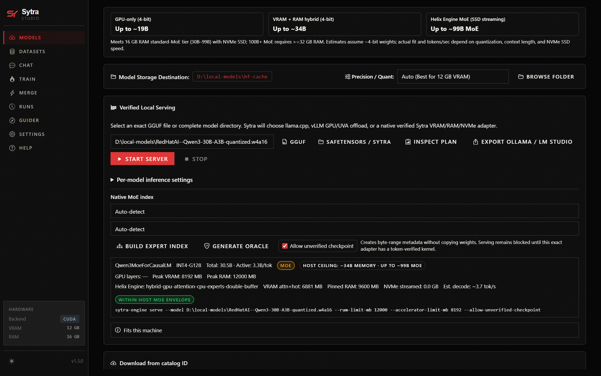
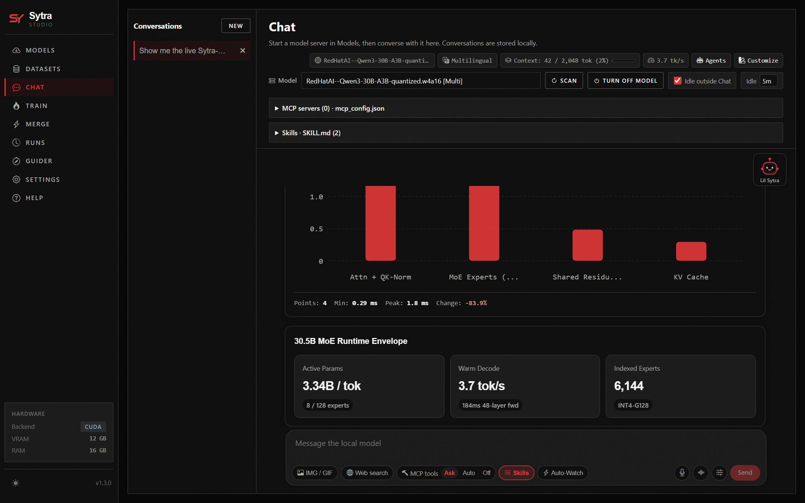
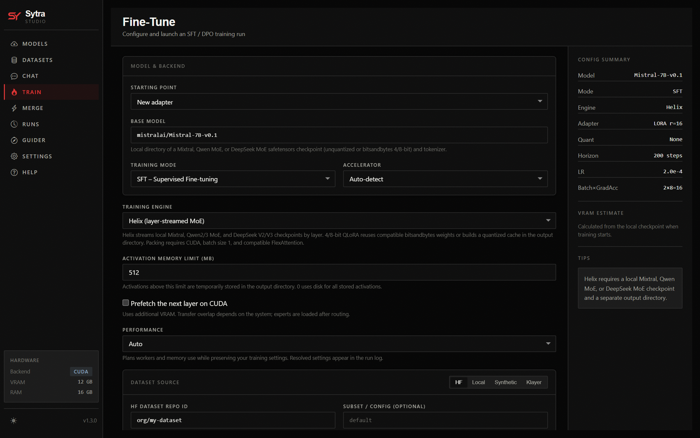
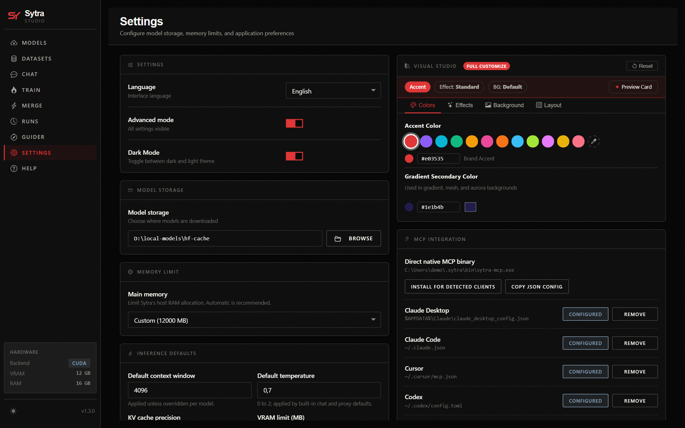

# Sytra Studio

Local, hardware-aware desktop studio and Model Context Protocol (MCP) server for discovering, indexing, fine-tuning, merging, chatting with, and serving local LLMs & Mixture-of-Experts (MoE) checkpoints.

**1.3.0 Documentation:**
[Release Notes](docs/releases/1.3.1.md) · [Migration Guide](docs/releases/1.3.0.md) ·
[MoE Builder Verification](docs/MOE_BUILDER_VERIFICATION.md) ·
[Helix Training Benchmark & Kernels](docs/HELIX_TRAINING_BENCHMARK.md) ·
[Semantic Dataset Curation](docs/DATASET_SEMANTIC.md) ·
[Chat & Inference Preferences](docs/CHAT_MODEL_PREFERENCES.md)

---

## Interface & Highlights (1.3.0)

| Models & Sytra-Helix 30B+ MoE Serving | Chat Workspace, Lil Sytra, Charts & Voice |
|---|---|
|  |  |
| **Native MoE Indexing & Verification:** `Build expert index`, `Generate Oracle`, `Allow unverified checkpoint`, per-model settings, and hardware ceiling badges. | **Intelligent Chat UI:** Minimalistic borderless assistant stream, interactive JSON/KPI charts, `@skill` injection, Lil Sytra custom agents, Kokoro-82M & Live Voice, and Auto-Watch briefings. |

| Helix Layer-Streamed MoE Training | Settings, Visual Customizer & Zero-NPM MCP |
|---|---|
|  |  |
| **Sytra-Helix SFT:** Layer-streamed LoRA/QLoRA across `mixtral`, `qwen2_moe`, `qwen3_moe`, `deepseek_v2`, and `deepseek_v3` with 4/8-bit `bitsandbytes` reuse & Triton kernels. | **Zero-NPM Setup & Synced Prefs:** One-click MCP configuration (`Claude Desktop`, `Claude Code`, `Cursor`, `Codex`, `VS Code`, `Antigravity`) and persistent VRAM/KV defaults. |

---

## Core Capabilities

- **Sytra-Helix MoE Engine (`sytra-engine`):** Native Rust + CUDA driver (`nvcuda.dll`) + CPU SIMD (`sytra_moe`) inference runtime supporting SafeTensors checkpoints from 7B to 744B+ parameters without loading all routed experts into VRAM. Includes warp-cooperative BF16 / INT4-G32 / INT4-G128 CUDA kernels, scratch buffer pooling, automatic LRU VRAM eviction under pressure, and OpenAI (`/v1/chat/completions`, `/v1/completions`) + Anthropic (`/v1/messages`) HTTP APIs on `127.0.0.1:8080`.
- **Chat, Lil Sytra Agents, Skills & Voice:**
  - **Lil Sytra & Custom Agents:** Configure personas, per-agent workspace folders, routines, and avatar companions in Chat. Agent workspaces are local directories on the host. Web Search uses the Wikimedia Action API for Wikipedia results by default. Set `BRAVE_SEARCH_API_KEY` in the Studio and inference server process environments to enable [Brave Search](https://api-dashboard.search.brave.com/documentation/quickstart) across the web. The optional Deno sandbox runs without network access. Local scheduled routines use a timer in the open Chat tab.
  - **Cloud Agent:** The separate Eve project runs Chromium browser tasks in Vercel Sandbox and includes an opt-in example for cloud scheduling. [Cloud Agent setup](cloud-agent/README.md).
  - **Workspace & User `@skill` Injection:** Autocomplete local `SKILL.md` skills and pair them with multi-server `mcp_config.json` registries, bounded tool-argument repair, and fail-closed `DenoSandbox` JS isolation.
  - **Interactive Rich Blocks & Telemetry:** Automatically renders markdown tables, structured `json` / `kpi` fences into interactive Bar/Line/Area/Pie SVG charts and KPI strips, alongside `tk/s` and token context pills.
  - **Voice Dictation, Kokoro-82M & Live Voice:** Real-time Whisper speech-to-text, local Kokoro-82M neural TTS playback, hands-free **Live Voice**, and scheduled **Auto-Watch** proactive briefings.
  - **Auto-Route & Lightweight Undo:** Deterministic task routing, 75%/85% auto-compaction, and a hover **"Undo changes"** checkpoint rollback button that restores conversation + workspace deltas cleanly.
- **Layer-Streamed Fine-Tuning (`Helix SFT`):** Helix streams frozen weights by layer for SFT with LoRA or 4/8-bit QLoRA on `mixtral`, `qwen2_moe`, `qwen3_moe`, `deepseek_v2`, and `deepseek_v3`. It includes Triton NF4 and cross-entropy kernels, FlexAttention packing, memory-mapped token data, and paged AdamW. The standard backend also supports DPO, ORPO, CPO, and DoRA.
- **Model Merger & MoE Builder:** SLERP, Linear, Task Arithmetic, TIES, DARE-TIES, DARE-Linear, Multi-SLERP, NuSLERP, Passthrough, and MoE Builder (`mergekit==0.0.5.1` with shared-expert fix in `sytra_runner.moe_exec`) with lineage preflight checks.
- **Dataset Fabric & Resilient Downloads:** Multi-source curation (`sytra_dataset_merge`, `sytra_dataset_split`), native tokenizer length filtering, deduplication, 13-gram local decontamination, semantic review (`dataset_semantic.py`), and commit-pinned Hugging Face/Xet transfers with multi-range fallback and SHA-256 verification.
- **Full MCP Parity (`35` Tools):** Everything from hardware planning, MoE indexing, oracle generation, and starting/stopping the `8080` inference server to training, merging, dataset curation, and chat skill/agent/voice inspection is exposed over standard MCP stdio (`sytra-mcp`).

---

## Helix Training and VRAM

Helix moves frozen base-model weights from host memory or storage to the GPU as
each layer needs them. This reduces peak GPU allocation. When the full model can
stay on the GPU, the standard path can process more tokens per second.

The following measurements use an RTX 3060 (12 GiB), 64 synthetic arithmetic
examples, FP32 LoRA, and two randomly initialized Mixtral checkpoints. The
traditional reference is Transformers + PEFT with the full model on CUDA.
Peak VRAM is PyTorch-allocated memory. Throughput counts supervised tokens.

| Mixtral size | Method | Median step | Tokens/s | Peak VRAM |
| --- | --- | ---: | ---: | ---: |
| 28.8M | Helix | 198.4 ms | 272 | 50.3 MiB |
| 28.8M | Transformers + PEFT | 56.6 ms | 968 | 150.9 MiB |
| 1.02B | Helix | 1.965 s | 26.4 | 283.0 MiB |
| 1.02B | Transformers + PEFT | 0.225 s | 244.8 | 4,187.5 MiB |

Helix reduced peak allocation by **67%** at 28.8M and **93%** at 1.02B. The
GPU-resident reference processed **3.6×** and **9.3×** as many supervised
tokens per second, respectively. With a **1 GiB PyTorch CUDA allocator limit**,
the 1.02B Helix run completed four measured steps at 282.6 MiB peak allocation.
The FP32 reference ran out of memory while moving the model to CUDA.
The measured 1.02B Helix run stored the same weights in separate expert tensors
after the grouped checkpoint triggered a native access violation on Windows.
[Benchmark methodology and reproduction](docs/HELIX_TRAINING_BENCHMARK.md).

---

## Cloud Agent Setup

The [Eve companion project](cloud-agent/README.md) runs separately on Vercel.
It uses an authenticated Eve client, Vercel AI Gateway for model calls, and
Chromium in Vercel Sandbox for browser tasks. Desktop agent profiles and
local Chat schedules stay in the Studio workspace.

1. Link and deploy `cloud-agent/` as a separate Vercel project using Node 24.
2. Enable AI Gateway in that project. The preview reached the agent service
   successfully. AI Gateway required a payment card on the team account before
   it would run a model turn.
3. Set `SYTRA_CLOUD_BROWSER_ORIGINS` to the exact HTTPS origins the agent can
   access. Interactive browser actions ask for approval.
4. To enable the example recurring site check, configure
   `SYTRA_CLOUD_ROUTINE_URL` and deploy the example schedule from the
   [setup guide](cloud-agent/README.md#enable-a-recurring-check).

The browser smoke test opened a TodoMVC demo, filled its input, and marked the
new item complete inside the remote Chromium session. The one-time preview
test left recurring schedules disabled.

---

## System Requirements

- Windows 10/11 (WebView2), macOS, or Linux
- Python 3.10+ and [`uv`](https://docs.astral.sh/uv/getting-started/installation/) on `PATH` (for isolated Python `train-env`, `merge-env`, and `voice-env` provisioning)
- Dedicated GPU strongly recommended for training and GPU-accelerated inference (Windows CUDA for `sytra-engine` uses `nvcuda.dll` from the NVIDIA driver directly)
- Sufficient disk space (NVMe SSD strongly recommended for cold-pass MoE streaming; spinning HDDs are bottlenecked by random seeks during initial expert caching)

> [!IMPORTANT]
> Always run **Inspect plan** (`plan_inference`) before launching large models or training runs so Sytra validates actual host VRAM, RAM, quantization, and disk envelope before allocating memory.

---

## Install

### Windows (PowerShell)

```powershell
irm https://raw.githubusercontent.com/walkowicz19/sytra-studio/main/scripts/install.ps1 | iex
```

Downloads `sytra-studio-windows.exe` and `sytra-mcp-windows.exe` into `%USERPROFILE%\.sytra\bin`, deploys embedded `runner/` scripts into `%USERPROFILE%\.sytra\runner`, adds `%USERPROFILE%\.sytra\bin` to `PATH`, creates a Start Menu shortcut, and configures detected MCP clients (`sytra-mcp.exe install --client auto`).

### Linux & macOS

```bash
curl -fsSL https://raw.githubusercontent.com/walkowicz19/sytra-studio/main/scripts/install.sh | sh
```

### Direct `.exe` / Portable Bundle

Download [sytra-studio-windows.exe](https://github.com/walkowicz19/sytra-studio/releases/latest/download/sytra-studio-windows.exe), [sytra-mcp-windows.exe](https://github.com/walkowicz19/sytra-studio/releases/latest/download/sytra-mcp-windows.exe), or the portable archive from [GitHub Releases](https://github.com/walkowicz19/sytra-studio/releases). Launching either standalone executable outside a repo clone automatically initializes `~/.sytra` (`%USERPROFILE%\.sytra` on Windows) and extracts its embedded `runner/`.

<details>
<summary>Optional: Install or run via NPM / npx</summary>

```bash
# Desktop
npx -y --prefer-online github:walkowicz19/sytra-studio

# MCP
npx -y --prefer-online github:walkowicz19/sytra-studio mcp

# Global install
npm install -g sytra-studio
sytra
sytra mcp
```

</details>

---

## Serving Large MoE Models (30B+) with Sytra-Helix

Sytra selects the serving backend automatically from checkpoint files:

| Checkpoint on Disk | Backend |
|---|---|
| `.gguf` file | `llama.cpp` |
| Complete SafeTensors fitting GPU or GPU + RAM | `vLLM` |
| SafeTensors MoE with `.sytra-runtime.json` | **Sytra-Helix MoE Engine** (`sytra-engine`) |

### Step-by-Step Setup (`UI`, `MCP`, or `CLI`)

1. **In the Desktop UI (`Models` -> switch to Advanced mode):**
   - Select or fill the model folder path (for example `D:\local-models\RedHatAI--Qwen3-30B-A3B-quantized.w4a16`).
   - Click **Build expert index** to generate `.sytra-runtime.json` from SafeTensors headers without copying weights.
   - Click **Generate Oracle** to create `.sytra-oracle.json`, or check **Allow unverified checkpoint** when running experimental/unverified SafeTensors weights.
   - Click **Inspect plan** to verify the `sytra_moe` placement envelope, then click **Start Server**.
2. **Via MCP (`sytra-mcp`):**
   - Call `list_local_models` -> `build_moe_index` -> `generate_moe_oracle` (or pass `allow_unverified: true`) -> `plan_inference` -> `start_server` -> send OpenAI requests to `http://127.0.0.1:8080/v1/chat/completions` -> `stop_server`.
3. **Via CLI:**

```bash
python runner/scripts/build_moe_index.py --model /path/to/model --adapter auto --expert-format auto
python runner/scripts/create_sytra_oracle.py --model /path/to/model      # optional; or pass --allow-unverified-checkpoint
target-build/release/sytra-engine doctor --model /path/to/model
target-build/release/sytra-engine plan --model /path/to/model --ram-limit-mb 12000 --accelerator-limit-mb 8192
target-build/release/sytra-engine serve --model /path/to/model --host 127.0.0.1 --port 8080 --allow-unverified-checkpoint
```

### Hardware Profiles

| Profile | Target Hardware | Execution Strategy |
|---|---|---|
| `vram_4gb_windowed` | 4 GB VRAM GPU + 16–64 GB RAM + NVMe | Layer windowing + GPU attention + CPU SIMD expert co-execution |
| `vram_8gb_hybrid` | 8 GB VRAM GPU + 16–64 GB RAM + NVMe | Full attention/MLA in VRAM + hot expert cache + CPU SIMD offload |
| `vram_12gb_balanced` | 12 GB VRAM GPU + 32–128 GB RAM + NVMe | Full attention/MLA + 6–8 GB hot expert cache + predictive lookahead |
| `vram_16gb_plus_prosumer` | 16–24 GB+ VRAM GPU + 32–128 GB+ RAM | Large VRAM hot pool + speculative MTP / N-gram verification |
| `cpu_only_native` | CPU only (AVX2 / AVX-512 / AMX / NEON) | Multi-threaded tiled quantized CPU kernels + pinned RAM + NVMe prefetch |

### Observed 30.5B MoE Verification (`RTX 3060 12 GB` + `16 GiB RAM`)

Verified end-to-end on Windows against `RedHatAI/Qwen3-30B-A3B-quantized.w4a16` (`15.57 GiB` on disk, `30,519,328,768` total params / `3,338,051,583` active params per token, `6,144` indexed experts across 48 layers):

| Run Mode | Configuration | Observed Result |
|---|---|---|
| Direct `sytra-engine serve` (`4096 MB` VRAM cap) | `max_tokens: 4` cold pass, then `max_tokens: 2` (`"Hi"`) warm pass | Cold pass returned `"<think>\nOkay,"` in `128.32s`; warm follow-up completed in `0.61s` (`184.61ms` 48-layer forward, `82.10ms` LM head logits) |
| Direct `sytra-engine serve` (`8192 MB` VRAM cap) | `max_tokens: 8` (`--allow-unverified-checkpoint`) | Completed HTTP `200` in `183.95s` (`"<think>\nOkay, the user is asking"`), with automatic VRAM eviction (`accelerator_evictions: 709`) preventing WDDM OOM |
| Live stdio `sytra-mcp.exe` (`4096 MB` VRAM cap) | `build_moe_index` -> `plan_inference` -> `start_server` -> HTTP POST -> `stop_server` | `plan_inference` verified `sytra_moe` (`meets_minimum_envelope: true`), `/health` returned `200`, `/v1/chat/completions` returned `200 OK` in `165.51s` (`3` completion tokens), `stop_server` freed port `8080` |

> [!NOTE]
> Cold first-pass timing above was recorded with the model stored on a 5400 RPM SATA HDD (`WDC WD20EZAZ`), where streaming several GB of initial expert shards is seek-bound until experts populate host RAM/VRAM cache. An NVMe SSD significantly reduces first-token cold streaming time.

---

## Fine-Tuning, Merging & Dataset Workflows

- **Train:** Open **Train**, choose a starting point (new adapter, post-train continuation, or full Trainer checkpoint resumption), pick `Standard` or `Helix (layer-streamed MoE)`, connect an HF / Local / Synthetic / Klayer dataset, and monitor live loss telemetry.
- **Datasets:** Preview Hugging Face or local `.jsonl` / `.parquet` splits, merge weighted datasets, filter exact/near duplicates or n-gram repetitions, apply native tokenizer min/max bounds, and run local semantic or 13-gram benchmark decontamination.
- **Merge & MoE Builder:** Validate lineage compatibility with **Merge Check**, combine adapters/checkpoints using SLERP / TIES / DARE-TIES / Task Arithmetic / Passthrough / MoE Builder, and publish atomically.

---

## MCP Server Setup & Complete Tool Reference (`35` Tools)

### Configure MCP Clients (No NPM)

```bash
sytra-mcp install --client auto
# or target specific clients:
sytra-mcp install --client claude-desktop,claude-code,cursor,codex,vscode,antigravity
sytra-mcp status
sytra-mcp print-config
```

You can also click **Install for detected clients** in **Settings -> MCP Integration**, or add the binary manually:

- **Codex** (`~/.codex/config.toml`):
  ```toml
  [mcp_servers.sytra-studio]
  command = "sytra-mcp"
  args = []
  ```
- **Claude Code:**
  ```bash
  claude mcp add sytra-studio -- sytra-mcp
  ```
- **Cursor / Claude Desktop / Antigravity** (`mcp.json` / `claude_desktop_config.json`):
  ```json
  {
    "mcpServers": {
      "sytra-studio": {
        "command": "sytra-mcp",
        "args": []
      }
    }
  }
  ```

### Complete `sytra-mcp` Tool Catalog (`35` Tools)

#### Environment & Global Settings (6)
| Tool | Key Arguments | Purpose |
|---|---|---|
| `get_status` | `—` | Active op status, detected accelerator (`cuda`/`mps`/`cpu`), VRAM/RAM, env readiness, and workspace path |
| `get_settings` | `—` | Read workspace `.sytra-settings.json` (`hf_cache_dir`, RAM/VRAM limits, context, temperature, KV quant) |
| `set_cache_dir` | `path` (`null` resets) | Set `HF_HOME` cache directory across desktop app and MCP |
| `set_main_memory_limit` | `limit_mb` (`>=2048` or `null`) | Cap host RAM budget used by preflight and resource guards |
| `configure_fast_cache` | `tokenless`, `low_bit_mode`, `vram_expert_cache_mb` | Configure tokenless HF access and default low-bit settings |
| `set_inference_settings` | `default_context_window`, `default_temperature`, `enable_flash_attention`, `kv_cache_quant`, `vram_limit_mb`, `cpu_kv_cache`, `vram_expert_cache_mb` | Persist global inference defaults synced with UI and proxy |

#### Catalog, Local Discovery & Downloads (6)
| Tool | Key Arguments | Purpose |
|---|---|---|
| `list_catalog` | `—` | List commit-pinned catalog models with VRAM/RAM and compatibility alerts |
| `list_local_models` | `custom_dir` (optional) | Scan local HF cache, LM Studio folders, workspace runs, and custom directories for GGUF/SafeTensors models |
| `download_model` | **`model`**, `dest_dir`, `purpose`, `quant`, `revision` | Start/poll a verified resumable Hugging Face/Xet download |
| `get_download_status` | `dest_dir` (optional) | Inspect progress and status of active/recent download |
| `cancel_download` | `dest_dir` (optional) | Abort an active download and clear its status marker |
| `guider_recommend` | `accelerator`, `vram_mb`, `ram_mb` | Recommend model + adapter + quantization recipes for host or specified hardware |

#### Sytra-Helix MoE, Conversion & Inference Server (11)
| Tool | Key Arguments | Purpose |
|---|---|---|
| `build_moe_index` | **`model_path`**, `adapter`, `expert_format`, `expert_regex` | Build `.sytra-runtime.json` zero-copy byte-range expert index for SafeTensors MoE checkpoints |
| `generate_moe_oracle` | **`model_path`**, `trust_remote_code`, `device_map` | Generate checkpoint-bound `.sytra-oracle.json` verification file via provisioned Python env |
| `plan_inference` | **`model_path`**, `context`, `export_runtimes`, `allow_unverified` | Preflight local checkpoint: detects backend, memory tiers, capacity envelope, and runtime command |
| `get_model_settings` | **`model_path`** | Read per-model overrides (`temperature`, `context_length`, `vram_limit_mb`, `kv_cache_quant`, `allow_unverified`, etc.) |
| `set_model_settings` | **`model_path`**, `context_length`, `temperature`, `vram_limit_mb`, `vram_guardrail_mb`, `kv_cache_quant`, `cpu_kv_cache`, `flash_attention`, `idle_ttl_minutes`, `draft_model_path`, `allow_unverified` | Persist per-model inference overrides applied on next server start |
| `start_server` | **`model_path`**, `context`, `vram_limit`, `cpu_kv_cache`, `allow_unverified` | Preflight and launch OpenAI-compatible proxy/server (`llama.cpp`, `vLLM`, or `sytra-engine`) on `127.0.0.1:8080` |
| `stop_server` | `—` | Stop the MCP-managed local inference server cleanly |
| `server_status` | `—` | Check managed server state and whether `127.0.0.1:8080` is listening |
| `convert_model` | **`model`**, `outtype`, `outfile` | Convert local SafeTensors directory to GGUF using `llama.cpp` |
| `export_model` | **`model`**, `name`, `context` | Generate Ollama `Modelfile` / LM Studio export manifests |
| `export_guide` | `artifact_path`, `kind` | Inspect adapter-merge/GGUF export prerequisites and exact commands |

#### Training, Merging & Run Telemetry (6)
| Tool | Key Arguments | Purpose |
|---|---|---|
| `start_train` | **`config`** (`run.schema.json`) | Start fine-tuning asynchronously. Standard supports SFT/DPO/ORPO/CPO. Helix supports SFT on compatible MoE checkpoints. |
| `merge_check` | **`models`**, **`method`**, `base_model` | Pre-check model compatibility and lineage before merging (`green`/`amber`/`red`) |
| `start_merge` | **`config`** (`merge.yaml`-shaped) | Start weight merge or MoE Builder job asynchronously |
| `list_runs` | `—` | List archived train/merge operations, statuses, and artifact paths |
| `get_run` | **`op_id`**, `tail` | Fetch run state and trailing telemetry/loss lines |
| `stop_op` | `op_id` (optional) | Cancel active train/merge process tree |

#### Dataset Curation (3)
| Tool | Key Arguments | Purpose |
|---|---|---|
| `preview_dataset` | **`source`**, `rows` | Inspect leading canonical `prompt`/`completion` rows of `hf`/`local`/`synthetic`/`klayer` source |
| `sytra_dataset_merge` | **`inputs`**, **`output_dir`**, `weights`, `total_samples`, `shard_rows`, `curation`, `seed` | Merge and curate local JSONL/Parquet corpora inside the workspace |
| `sytra_dataset_split` | **`input`**, **`output_dir`**, `validation_fraction`, `seed` | Deterministically split conversations into `train`/`val` without group leakage |

#### Chat Skills, Agents & Voice (3)
| Tool | Key Arguments | Purpose |
|---|---|---|
| `list_chat_skills` | `—` | Discover local `SKILL.md` chat skills across workspace and user directories |
| `list_chat_agents` | `—` | List configured chat agent profiles (`Lil Sytra` and custom agents) |
| `get_voice_status` | `—` | Report Kokoro-82M / Whisper runtime readiness and available voices |

---

## Developer Guide

### Repository Layout

- `ui/` — Svelte 5 desktop frontend (`tests/` Node unit suites + Playwright E2E)
- `src-tauri/` — Tauri 2 desktop shell & IPC commands
- `crates/sytra-contracts/` — Shared catalog, schemas (`run.schema.json`), and telemetry contracts
- `crates/sytra-host/` — Shared orchestration, hardware detection, download/voice/skills/agents/serve services
- `crates/sytra-mcp/` — Zero-NPM standalone MCP stdio server & client installer
- `crates/sytra-engine/` — Native **Sytra-Helix MoE Engine** (`sytra_moe` runtime + CUDA driver FFI + SIMD kernels)
- `runner/` — Python training (`train-env`), merge (`merge-env`), voice (`voice-env`), dataset curation, and inference planner
- `scripts/` — Zero-NPM Windows/macOS/Linux installers
- `docs/` — Release notes, kernel/benchmark reports, and architecture docs

### Build from Source

Prerequisites: stable Rust toolchain, Node.js 20+, and (on Windows) Visual Studio Build Tools with the Desktop C++ workload.

```bash
cd ui && npm ci && npm run build && cd ..
cargo build -p sytra-engine --release
cargo build -p sytra-mcp --release
cargo build -p sytra-studio --release --features custom-protocol
```

Compiled binaries are emitted to `target-build/release/` (`sytra-studio.exe`, `sytra-mcp.exe`, `sytra-engine.exe` on Windows).

Development hot-reload UI:

```bash
cd ui && npm run dev
# in another terminal:
cargo tauri dev --config src-tauri/tauri.conf.json
```

### Sytra-Helix Adapter Contracts (`sytra-engine list-adapters`)

`sytra-engine` includes compiled adapters for `sytra-glm52`, `sytra-kimi-k2.7-code`, `sytra-kimi-k3`, `sytra-inkling`, `sytra-deepseek-v3`, `sytra-qwen3-moe`, `sytra-qwen2-moe`, `sytra-mixtral`, `sytra-olmoe`, `sytra-dbrx`, `sytra-granite-moe`, `sytra-arctic`, `sytra-grok`, `sytra-llama4-moe`, `sytra-ernie-moe`, `sytra-jamba-moe`, `sytra-minimax-moe`, and `sytra-generic-moe`.

### Tests

```bash
# Rust workspace unit + integration suites
cargo test --workspace

# Python runner suite (using provisioned train-env with PYTHONPATH=runner)
PYTHONPATH=runner .sytra-envs/train-env/Scripts/python.exe -m pytest runner -q
# Windows PowerShell:
# $env:PYTHONPATH='runner'; .\.sytra-envs\train-env\Scripts\python.exe -m pytest runner -q

# UI typecheck, Node unit tests, and Playwright E2E suite
node --test ui/tests/chat-stream.test.mjs ui/tests/voice-controller.test.mjs
cd ui && npm run check && npm run test:e2e && cd ..
```

---

## License

[MIT](LICENSE)
